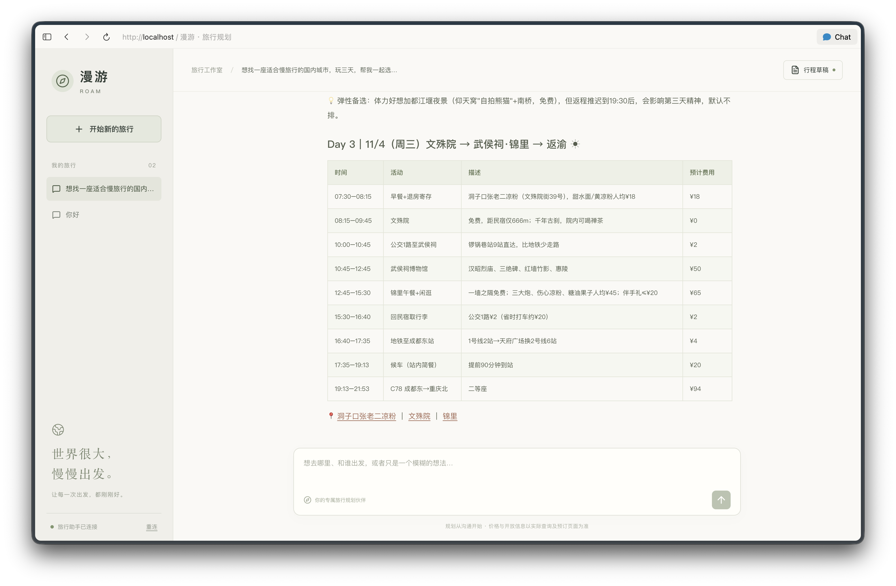
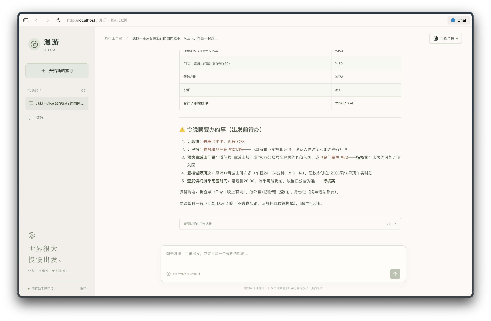

# 漫游 · Travel Agent

一个基于 Deep Agents 与 LangGraph 的国内旅行规划助手。从目的地选择、预算讨论，到交通住宿推荐与每日行程，帮助你把旅行想法变成可执行的计划。

## 功能

- **对话式需求确认**：结合出行日期、人数、兴趣和节奏，推荐候选景点与体验，确认必去项目。
- **交通、酒店与预算**：通过飞猪查询大交通和住宿，提供预订链接，汇总预计花费与预算余量。
- **每日详细行程**：专用子代理统筹景点、餐厅、路线和停留时间，结合高德地图与网络搜索核实位置、交通和开放信息。
- **行程展示与导出**：使用 Markdown 表格展示每天的时间、活动、描述、链接和预计费用，支持查看和下载行程草稿。
- **持续沟通与局部修改**：保留会话和规划历史，可以继续调整某一天或某个活动。
- **可见、可停止的执行过程**：支持流式回复、工具活动记录和后台任务取消；Web 界面适配手机，支持 Docker 本地启动。

当前支持查询和规划，不代客下单或支付。前端采用 React、TypeScript、Vite 与 Tailwind CSS，后端使用 Python、Deep Agents 和 LangGraph；Tauri 移动端封装尚未实现。

## 界面预览

### 每日行程

按时间展示景点、餐饮、途中交通与预计费用，附相关地点和预订链接。



### 预算与出发前待办

汇总旅行支出、预算余量及预约提醒，保留待核实信息，并支持继续对话修改。



截图为一次规划示例，其中的价格、时刻和预约信息以实际查询及预订页面为准。

## Web 与 Docker 本地联调

前端位于 `web/`，采用 React、TypeScript、Vite、React Router、Tailwind CSS 和 LangChain 官方 React SDK。支持流式聊天、历史会话、工具活动、停止后台任务，以及 Markdown 行程查看和下载。布局适配手机，后续可接入 Tauri；当前尚未加入 Tauri 工程。

当前按本地开发部署：Docker 内运行 `langgraph dev`，不需要 LangSmith。它使用开发运行时与持久卷，不是 PostgreSQL/Redis 生产版 Agent Server。没有用户鉴权，只绑定本机端口。

先在项目根目录 `.env` 配置模型、高德和飞猪密钥，再启动 Docker 引擎：

```bash
docker compose up --build -d
```

打开 http://localhost:8080 。Agent API 位于 http://localhost:8123 ，Web 经 `/api` 反向代理访问，流式代理已关闭缓冲。镜像内包含 Python 依赖、Node.js、飞猪 CLI、提示词与 skills；密钥只在运行时注入，不进入镜像和前端。

前端热更新开发可以只启动 Agent 容器：

```bash
docker compose up --build -d agent
npm ci --prefix web
npm run dev --prefix web
```

打开 http://localhost:5173 。Vite 默认将 `/api` 转发至 `http://127.0.0.1:8123`；使用已有非 Docker 服务时可用 `AGENT_SERVER_URL=http://127.0.0.1:2024 npm run dev --prefix web`。前端只读取 `VITE_AGENT_API_URL` 这一公开配置，绝不能把服务端密钥加上 `VITE_` 前缀。

`langgraph.docker.json` 不读取镜像内的 `.env`，环境变量由 Compose 注入。它沿用本地开发运行时专用的启停清理策略：停止服务即取消任务，重启不恢复遗留任务；聊天和 `/daily-itinerary.md` 随 `/app/.langgraph_api` 保存在 `agent-data` 卷中。`docker compose down` 保留数据，`docker compose down -v` 会删除数据。

```bash
# 检查服务与日志
docker compose ps
docker compose logs -f agent
# 停止服务，保留会话
docker compose down
# 验证前端构建及 Python 集成
npm run build --prefix web
.venv/bin/python -m unittest test_agent -q
# 浏览器测试，需已有 Vite 或 Docker Web 服务
cd web
npx playwright install chromium
npm run test:e2e
# 可选真实模型验证（会调用所配置模型）
LIVE_AGENT_TEST=1 npm run test:e2e
# 验证完整 Docker Web，可指定 WEB_URL=http://127.0.0.1:8080
```

移动设备上的 localhost 指向设备本身。后续 Tauri 真机接入时需配置可访问的 API 域名、HTTPS、跨域来源和登录鉴权；不在安装包中嵌入模型或工具密钥。

## 代理分工

基于 Deep Agents 构建的旅行规划系统，使用 `qwen3.8-flash`。主代理与用户确认交通、住宿、预算、必去项目与旅行偏好后，用自然语言委派 `daily_planner`；子代理通过原生 `write_file` / `edit_file` 保存 Markdown 行程文件，主代理通过 `read_file` 读取并展示。

- 百炼原生 `web_search`：查询攻略、开放时间、预约要求和最新公告。
- 高德 HTTP MCP：地点、路线和可查询的天气，工具由服务端动态发现。
- 飞猪官方 skill + CLI：查询交通、酒店和门票。
- 子代理保留同一线程的委派、查询和行程历史；局部修改只需说明变更，无须重传全部需求。
- 需求和偏好通过自然语言委派，完整详细行程通过当前线程的 Markdown 文件交付。
- 关闭通用子代理与 shell；仅开放专用 `daily_planner`，不代客下单或支付。

## 规划与 Markdown 交付

主代理与用户确认具体到离时间、地点、逐晚住宿、预算和旅行偏好后，用自然语言委派 `daily_planner`。主代理帮助筛选感兴趣的景点、餐厅与体验，不预先分配每日地点或路线；子代理根据必去项目、候选和固定预约统筹全部天数。子代理保留同一线程的历史，局部修改只需说明变更，每次提交全部天数的完整行程。

子代理首次用 `write_file` 创建 `/daily-itinerary.md`，后续先读取，再用 `edit_file` 修改，文件保留全部天数的最新行程。保存成功后简短报告完成。主代理对该文件的写入由框架权限明确拒绝，子代理可创建和修改。主代理通过 `read_file` 读取并向用户展示，内容截断时继续分页读取。表格列为 `时间 | 活动 | 描述 | 链接 | 预计费用`。

行程文件使用 Deep Agents 原生线程文件状态，随检查点持久化；不同线程隔离，不是项目目录中的共享磁盘文件。子代理的文件更新通过框架传回主线程。未能完成修改时说明问题，不覆盖上一版，也不将旧版称作本次修改结果。

当前不调用转换 AI，不生成或校验结构化行程。`itinerary.py` 中的 Pydantic 模型保留，供后续结构化功能使用；当前尚未实现最终确认入库。

主／子代理仍可阅读飞猪 skill 和参数文档，按文档直接调用 `flyai(command, arguments)`；`/skills/` 保持只读。

## 安装与配置

需要 uv、Python 3.12+；Web 开发推荐 Node.js 22 LTS 或更新的受支持版本。已有 `.env` 时不要覆盖。

```sh
uv sync --locked
npm ci
cp .env.example .env
```

配置 `.env`：

```dotenv
TRAVEL_MODEL=qwen3.8-flash
DASHSCOPE_API_KEY=你的百炼密钥
DASHSCOPE_BASE_URL=https://dashscope.aliyuncs.com/compatible-mode/v1
AMAP_MAPS_API_KEY=你的高德Key
FLYAI_API_KEY=你的飞猪密钥
```

百炼密钥与接口地域须一致。高德 MCP 必须能连接并提供工具；飞猪支持试用，正式使用可配置 Key。密钥仅保存在本地 `.env`，已加入 gitignore。

## 体验

```sh
uv run langgraph dev
```

打开终端输出的 Studio 链接，选择 `travel_agent`。启动时不连接远程工具，实际对话时才加载模型和高德 MCP。

本地 dev 默认“关闭就停止”：正常关闭服务时取消未完成任务；重启时先取消上次遗留的 `pending`／`running` 任务，不自动续跑。对话历史、检查点和Markdown 行程文件仍然保留，可以由用户发送新消息继续。强制终止进程时，清理会在下次启动执行。此策略由 `dev_server.py` 的 HTTP lifespan 钩子实现，使用本地 in-memory runtime 的取消接口；升级服务端依赖后需验证生命周期顺序。若要恢复框架默认的重启续跑行为，移除 `langgraph.json` 中的 `http.app` 配置。关闭浏览器页面不等于关闭服务。

可以这样连续对话：

1. `我想从上海去杭州玩三天，先帮我明确需求。`
2. `12月1日至3日，两位成人，一间房，两人共4000元，含往返、住宿、餐饮、当地交通、门票和机动费用。没有预订，想轻松游。`
3. `交通、酒店和预算都可以，西湖必去，其他按文化和美食为主安排，节奏轻松。`
4. `第二天不要登山，其他安排尽量保留。`
5. `这份行程确定了，列出预约和出发前待办。`

## 验证与执行边界

```sh
uv run python -m unittest -v
```

离线测试通过真实 SDK 的模拟 HTTP 响应，检查原生工具、Markdown 文件提交和读取、跨轮修改、未完成修改时保留草稿、线程隔离、子代理记忆和工具并发上限。保留 Pydantic 模型校验测试。不会进行付费查询。

模型运行使用 Responses API，关闭思考，输出上限 8192 token；单次模型请求超时 120 秒，飞猪 CLI 超时 90 秒。子代理的查询次数没有额外限制；行程提交次数按上文限制。`parallel_tool_calls=True` 允许模型同轮提出多个工具调用；主代理和子代理各自使用 `max_concurrency=3`，每个代理最多同时执行3个工具，其余排队。这是每个代理的执行上限，不是跨线程或高德服务的全局QPS限制。

离线测试不能证明真实价格、库存、预订链接或景点开放状态正确，仍需在实际查询中核实。

## 文件

- `agent.py`：主代理与工具组装、飞猪 CLI 查询、异步图工厂。
- `daily_planner.py`：有历史的规划子代理配置。
- `dev_server.py`：本地 dev 启停时取消未完成任务，保留对话和行程草稿。
- `system_prompt.md`：主代理需求沟通、自然语言委派与表格展示约定。
- `daily_planner_prompt.md`：子代理的自然语言提交、记忆复用与查询约定。
- `itinerary.py`：Pydantic 行程模型、连接与时序校验。
- `test_agent.py`：原生工具、Markdown 文件交付、线程隔离与有历史的子代理委派集成检查。

## 官方资料

- [百炼原生联网搜索](https://help.aliyun.com/zh/model-studio/web-search)
- [百炼结构化输出](https://help.aliyun.com/zh/model-studio/qwen-structured-output)
- [高德 MCP 快速接入](https://developer.amap.com/api/mcp-server/gettingstarted)
- [飞猪官方 skill](https://github.com/alibaba-flyai/flyai-skill)，本地来源见 `skills/SOURCE.md`。
- [Deep Agents 文档](https://docs.langchain.com/oss/python/deepagents/customization)
